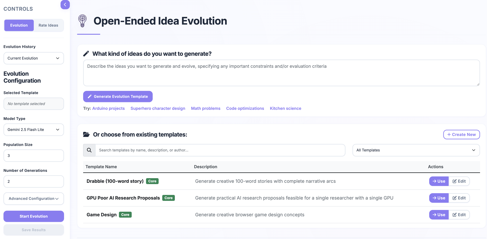
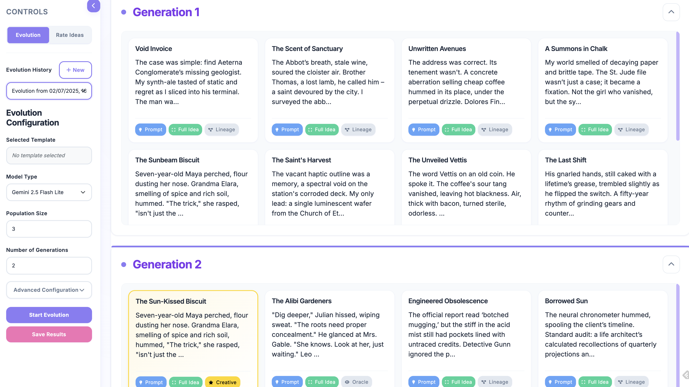
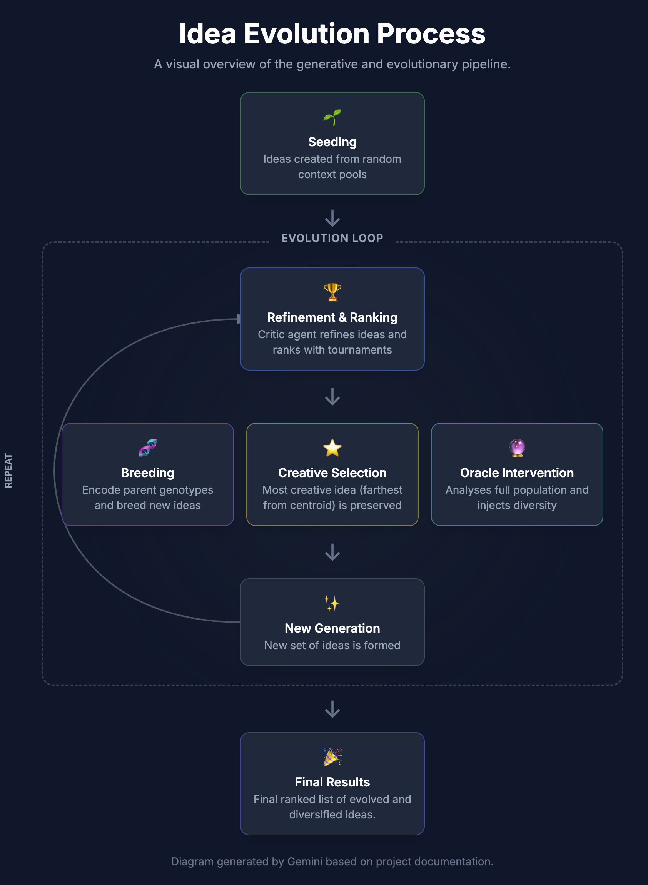

# Idea Evolution

Idea Evolution is a small web app that uses multiple LLM agents (Ideator, Critic, Breeder, Oracle) to generate, evolve, and rate ideas over several generations. You can run a full end‑to‑end evolution, visualize diversity, and rank ideas manually or automatically.





## What you can do

- Generate and evolve ideas with Gemini models (2.0 and 2.5 variants)
- Track population diversity over generations (embeddings‑based)
- Keep a configurable fraction of each generation as survivors (instead of full replacement)
- Use hybrid fitness for selection: normalized Elo + normalized diversity
- Apply age‑decayed survival pressure so very old ideas phase out gradually
- Rate ideas with an ELO‑style tournament (manual and automated)
- Create and edit YAML prompt templates in the UI
- Save/load evolutions and re‑rate them later
- Configure a versioned evaluator suite in the backend (the existing LLM
  tournament + diversity behavior remains the default)

## Quickstart

1) Install dependencies

```bash
uv sync
```

2) Configure your API key

```bash
export GEMINI_API_KEY=your_api_key_here
```

3) Run the app

```bash
uv run uvicorn idea.viewer:app
```

For local Codex/browser testing where Google popups get in the way, you can
enable the localhost-only development auth shim:

```bash
IDEA_DEV_AUTH=1 uv run uvicorn idea.viewer:app --host 127.0.0.1 --port 8000
```

The development shim uses a per-process random bearer token and is non-admin by
default; set `IDEA_DEV_AUTH_ADMIN=1` only when admin testing is required.
`run_local.sh` also binds to `127.0.0.1` unless `IDEA_BIND_HOST` is explicitly
set. Browser access is same-origin by default; a separate frontend must be
allow-listed with comma-separated `IDEA_CORS_ORIGINS`.

Local JSON exports are stored in an opaque per-user directory under
`data/local-users/`. Root-level `data/*.json` files are not exposed through the
rating or history APIs by default. For a temporary legacy migration, opt in
explicitly with `IDEA_ALLOW_UNSCOPED_LEGACY_LOCAL_FILES=1`; rating a legacy file
creates a private user-scoped copy and leaves the root file unchanged.

4) Open the UI

- Evolution viewer/creator: http://localhost:8000/
- Idea rater: http://localhost:8000/rate

## A 1‑minute tour

- Pick a template (or generate a new one), choose model and population settings, then click Start Evolution.
- Watch ideas arrive plus a diversity chart for each generation.
- Each generation keeps some survivors and breeds only the configured replacement fraction.
- Parent selection for children is weighted by hybrid fitness (`alpha * elo_norm + (1 - alpha) * diversity_norm`).
- Survivor selection uses the same fitness with an age decay factor so older ideas are less likely to persist forever.
- The Oracle can still replace the least interesting idea (closest to the centroid) to avoid convergence.
- Use Save Results to snapshot an evolution; visit Rate Ideas to compare and rank saved runs (manual or automated; costs are estimated and shown).

See the explainer: `docs/EvolutionOverview.md`.

## Running tests

```bash
uv run pytest -q
```

## Structure (high‑level)

- `idea/viewer.py` – FastAPI app serving the viewer, rater, and template APIs
- `idea/evolution.py` – Evolution engine, hybrid fitness, survivor selection, parent allocation, diversity tracking
- `idea/evaluation/` – Typed evaluator configs/results, legacy LLM/diversity adapters, fitness aggregation, and script result contracts
- `idea/artifact_store.py` – Contained, content-addressed local artifact storage
- `idea/llm.py` – LLM wrapper and agents (Ideator, Formatter, Critic, Breeder, Oracle)
- `idea/prompts/` – YAML templates system, validation, loader, and Oracle prompt bundle
- `idea/static/` – Frontend HTML/CSS/JS (viewer and rater UIs)

## Templates

YAML templates live in `idea/prompts/templates/`.

- `airesearch.yaml` – GPU‑poor AI research proposals
- `game_design.yaml` – Browser game designs
- `drabble.yaml` – 100‑word stories

Create new templates from the UI (on the main page) or by adding YAML files. See `idea/prompts/templates/README.md` for the schema.

## Configuration tips

- Models and pricing are defined in `idea/config.py` and used to estimate token costs for evolution and auto‑rating.
- Gemini 3 models use thinking levels; Gemini 2.5 models use thinking budgets. The UI exposes the supported control for each model.
- Advanced evolution controls include:
  - `mutationRate` (breeding mutation on new children)
  - `replacementRate` (fraction of population replaced per generation)
  - `fitnessAlpha` (weight of Elo vs diversity in hybrid fitness)
  - `ageDecayRate` (how quickly older ideas lose survival probability)

## Evaluators and artifacts

Evaluation is being migrated from a hard-wired LLM tournament to a composable
suite. Runs with no explicit `evaluation` configuration retain the legacy
behavior: pairwise LLM Elo weighted by `fitnessAlpha`, embedding diversity
weighted by `1 - fitnessAlpha`, then age decay for survivor selection.

The typed backend now supports explicit metric direction, normalization,
weights, failure policies, and a no-evaluation mode. A Python metric evaluator
can consume the strict JSON contract documented in
[`docs/PluggableEvaluators.md`](docs/PluggableEvaluators.md) through an injected
execution runner. Generated code execution is intentionally not enabled in the
web app: it requires the isolated no-network container backend described in the
design before it is safe to expose.

Local artifact output can be imported into the content-addressed artifact store
after traversal, symlink, media-type, size, and digest checks. Firestore history
stores references rather than artifact bytes.

The bundled `prime_visualization` template turns the Ulam spiral into a
baseline/anti-copy reference and asks for explicit mappings, falsifiable nulls,
deterministic implementation plans, and PNG/metadata/result contracts. It does
not execute generated code or claim that proposed patterns were observed.

## Troubleshooting

- “GEMINI_API_KEY environment variable is not set” banner: export the key and restart the app.
- Empty diversity chart for “current evolution”: save the evolution and re‑open it from the list (see also known issue in `TODO.md`).

## Roadmap

See `TODO.md` for planned features, research ideas, and open bugs.
