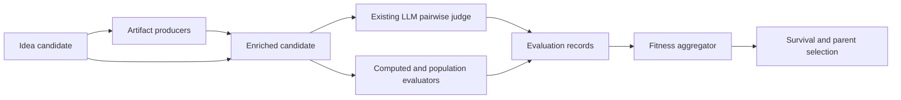

# Pluggable evaluators and artifact-producing ideas

Status: typed evaluation foundation plus the first opt-in artifact-producing and
multimodal pairwise slice are implemented on `codex/pluggable-evaluators`.

## Goal

Make evaluation optional and composable. Preserve the current LLM Swiss-tournament behavior while supporting deterministic or domain-specific metrics and artifact-producing implementations that enrich the candidates shown to that same judge.

Examples this architecture must support:

- the current pairwise LLM judge plus embedding diversity;
- a computed evaluator backed by a checked-in Python function that returns numeric fitness such as accuracy or pLDDT;
- an LLM-produced Python visualization that enriches the candidate before the existing pairwise judge compares it;
- several independent metrics combined into selection fitness;
- display-only evidence that does not affect selection;
- no evaluation at all for runs that only generate and inspect ideas.

## Core separation

The pipeline has four responsibilities:

1. **Artifact producer** — enriches a candidate with evidence, such as source code and a rendered image, before judging.
2. **Evaluator** — observes an enriched candidate, pair, selection pool, or global population and emits typed measurements. A generic computed evaluator may use any implementation behind its runner boundary.
3. **Fitness aggregator** — normalizes configured measurements and computes the scalar selection fitness.
4. **Survival policy** — applies age decay and other population policies after fitness; this is not evaluation.



Components declare the evidence they require and provide. Artifact producers
and computed evaluators execute in declared order before the `llm_pairwise`
component, so `LLM code -> PNG -> optional computed scorer -> enriched
candidate -> existing judge` is one ordered pipeline. Artifact dependencies
must be provided by an earlier component. There is deliberately no separate
artifact-specific LLM scorer: visual evidence becomes part of the candidate
judged by the existing comparison policy. Independent numerical methods use a
generic computed runner and may be combined with the pairwise score.

## Candidate and evidence contracts

The existing candidate dictionary remains readable during migration, but new data is typed and serializable:

```python
{
    "id": "...",
    "idea": {"title": "...", "content": "..."},
    "parent_ids": ["..."],
    "artifact_ids": ["artifact-..."],
    "artifact_refs": [
        {
            "id": "artifact-...",
            "role": "primary",
            "media_type": "image/png",
            "storage_key": "art-sha256-...",
            "sha256": "...",
            "size_bytes": 12345,
            "producer_id": "render",
            "content_digest": "...",
        }
    ],
    "evaluations": {
        "render_and_measure": {
            "status": "ok",
            "metrics": {"structure_signal": 0.82},
            "normalized_metrics": {"structure_signal": 0.82},
            "artifact_ids": ["artifact-..."],
        }
    },
    "selection_metrics": {
        "fitness": 0.74,
        "components": {
            "render_and_measure.structure_signal": {
                "status": "used",
                "weight": 0.8,
                "raw_value": 0.82,
                "score_value": 0.82,
            },
            "diversity.diversity": {
                "status": "used",
                "weight": 0.2,
                "raw_value": 0.42,
                "score_value": 0.42,
            },
        },
    },
}
```

Artifact binaries do not belong in Firestore generation history. `ArtifactRef` contains an opaque storage key, media type, byte size, digest, role, producer identity, and content digest. Local disk is the first artifact-store backend; object storage can implement the same interface later.

Each `EvaluationRecord` includes:

- evaluator ID, kind, and version;
- generation and scope;
- `ok`, `failed`, `skipped`, or `cached` status;
- raw and normalized metrics;
- referenced artifact IDs;
- concise summary or rationale;
- explicit error details;
- duration and input digest.

Failures are never converted into ties or numeric zero. A component config chooses one policy:

- `fail_run`: stop aggregation when the configured evidence is unavailable;
- `penalize`: contribute the configured penalty score and retain the failure;
- `omit`: omit the metric and renormalize the remaining weights.

Display-only evidence is represented by leaving the component out of the
fitness metric list (or assigning it zero weight), so its record remains
inspectable without influencing selection.

## Computed-runner result contract

Computed evaluator runners and isolated producers return a strict result rather than encoding data in console output:

```json
{
  "schema_version": 1,
  "status": "ok",
  "metrics": {
    "score": 0.82,
    "plddt": 91.4
  },
  "artifacts": [
    {
      "path": "visualization.png",
      "role": "primary",
      "media_type": "image/png"
    }
  ],
  "summary": "Optional short explanation"
}
```

Metric configuration provides selection weight, optional bounds, and normalization strategy. Every evaluator output follows one convention: a larger value is always fitter. A runner measuring a minimize-only quantity such as latency or error must convert it at its own boundary—for example to negative latency, reciprocal latency, or bounded efficiency—and name the emitted score accordingly. The aggregator never guesses how to invert a domain metric. This permits a raw AlphaFold-like score without pretending all domain metrics naturally lie in `[0, 1]`.

The engine enforces each computed component's declared timeout with
`asyncio.wait_for`. A timeout produces a failed evaluation record and is then
handled by the metric's configured failure policy; it is never converted to a
zero or tie.

`builtin.character_count` is the first reviewed in-process runner. It accepts
one declared metric and can count `content`, `title`, or `title_and_content`,
optionally excluding whitespace. It performs no dynamic import, source
execution, subprocess, filesystem, or network access, so the web path may use
it without an external execution backend. It is intentionally a simple
contract example—not a recommendation that verbosity should normally be part
of fitness:

```yaml
- id: length
  kind: computed
  runner_ref: builtin.character_count
  metric_names: [character_count]
  parameters:
    field: content
    include_whitespace: true
```

## Generated-code security boundary

Generated code must never execute directly inside the FastAPI/Uvicorn process.
A subprocess timeout is useful operationally but is not a security boundary.

The first implemented backend is `GeminiCodeExecutionRunner`. It is disabled
by default and must be constructed with `enabled=True`, registered under the
component ID or execution profile, and paired with an explicitly supplied
`ArtifactStore`. It uses only the Gemini Interactions API `code_execution` tool
with the fixed `gemini-3.6-flash` model. Generated Python runs in Google's Code
Execution environment; the app only parses the interaction, bounds and
validates exactly one inline PNG, and stores the returned source, PNG, and JSON
metadata. It never executes the generated source locally.

Candidate text is delimited as untrusted data in the producer prompt and may
not override the fixed system, tool, output, or security instructions. Only prompt and
candidate-content digests are persisted, not a duplicated prompt. Usage and
interaction provenance are retained in typed evaluation metadata. The web app
constructs a runner and private per-user/per-evolution artifact store only when
`IDEA_ENABLE_GEMINI_CODE_ARTIFACTS=true`; the suite must independently opt in
with `allow_generated_code_execution=true`. Otherwise the component remains
unavailable. The runner requests non-stored interactions, uses an 8,192-token
default output cap, and never sends credentials in candidate content.

The pairwise `Critic` loads referenced bytes through an injected artifact
loader, verifies size and digest, rejects stale or ambiguous required refs, and
sends each candidate's text and PNGs together in the same model call. Both the
tournament cache and the Critic's local cache include artifact digests. Missing
artifacts, corrupt bytes, timeouts, provider exceptions, invalid winners, and
nonconforming judge responses remain explicit failed evidence; no Elo update or
neutral tie is created. User-requested stop remains a cancellation and does not
apply unfinished evidence.

An optional future local generated-code backend would invoke a pinned Docker or Podman
image with:

- no network;
- a non-root user;
- a read-only root filesystem;
- all capabilities dropped and `no-new-privileges`;
- CPU, memory, PID, wall-time, log, file-count, and output-size limits;
- candidate input and source mounted read-only;
- one empty per-job output directory mounted writable;
- no project tree, home directory, container socket, credentials, API keys, or inherited environment;
- pinned NumPy, Matplotlib, and Pillow dependencies, with no runtime installation;
- a fixed command such as `python -I /input/main.py`, never an LLM-generated command.

Before committing outputs, the host rejects traversal, symlinks, device files, unsupported or spoofed media types, and oversized files. Executable templates may suggest a known preset, but custom template text can never silently enable local execution. Every run requires an explicit execution setting and persists its resolved profile and code digest.

## Backward compatibility

Runs with no `evaluation` config resolve to the legacy suite:

- `llm_pairwise.quality_elo` with weight `fitness_alpha`;
- `embedding_diversity.diversity` with weight `1 - fitness_alpha`;
- existing age-decay settings unchanged.

During migration, the system continues writing the `elo`, `diversity`, and `fitness` aliases consumed by existing history, tree, ranked, and chart views.

The first extraction wraps the existing Critic/Swiss implementation; it does not rewrite the tournament algorithm. Critique/refinement remains separate from judging even if both temporarily use the same `Critic` instance.

## Prime-visualization preset

The spiral recalled in the project brief is the Ulam spiral, but it should not anchor the search. The prompt offers a deliberately optional, non-exhaustive precedent palette:

- integer paths such as the Ulam square spiral, the Sacks number spiral (whose construction aligns perfect squares on a ray), and other number-spiral or lattice orderings;
- modular residue grids, wheels, and Chinese-remainder coordinates, plus cyclic multiplication maps shown as tables or circle chords;
- prime-gap and constellation sequences, and prime races that compare cumulative counts in reduced residue classes for a fixed modulus;
- Pascal/binomial arrays encoded by residues, divisibility, or valuations;
- factor-pair geometry, divisor lattices, and recursive factorization diagrams.

These are seeds rather than recipes. A proposal can ignore the palette or abstract at most a couple of principles—sequence-to-geometry, periodic coordinates, orbit structure, cumulative lead changes, recurrence texture, or product hierarchy—and must then define a materially different mapping and falsifiable test. Cosmetic restyling, reparameterizing one known construction, or collaging finished precedents does not count as novelty. The palette descriptions are grounded in the [Sacks number-spiral construction](https://www.dcs.gla.ac.uk/~jhw/spirals/), the [AMS definition of prime races](https://www.ams.org/tran/0000-000-00/S0002-9947-2020-07996-3/), [Pascal's triangle and binomial encodings](https://mathworld.wolfram.com/PascalsTriangle.html), and [factorization diagrams discussed by the AMS](https://blogs.ams.org/blogonmathblogs/2017/07/11/take-the-math-less-traveled/).

A runnable first web preset (also emitted by the off-by-default Advanced Config
switch when the server opt-in is active) is:

```yaml
evaluation:
  enabled: true
  allow_generated_code_execution: true
  components:
    - id: render
      kind: llm_code_artifact
      execution_profile: matplotlib-prime-v1
      artifact_role: primary
      source_role: source
      metadata_role: metadata
      provides: [artifact.primary, artifact.source, artifact.metadata]

    - id: quality
      kind: llm_pairwise
      requires: [artifact.primary]
      metric_name: quality_elo
      failure_policy: fail_run

    - id: diversity
      kind: embedding_diversity
      metric_name: diversity

  fitness:
    strategy: weighted_sum
    metrics:
      - component_id: quality
        metric_name: quality_elo
        weight: 0.7
        normalization: running_zscore
      - component_id: diversity
        metric_name: diversity
        weight: 0.3
        normalization: running_zscore
```

The producer prompt requires deterministic, noninteractive Python, a bounded prime range, fixed random seed, PNG output, and metadata explaining how integers map to positions, marks, and color. It also requires a null or matched control and a predeclared disconfirming outcome. The computed runner can publish a predeclared quantitative structure signal. The existing pairwise judge now compares enriched candidates in one multimodal call for mathematical fidelity, legibility, revealed prime structure, novelty beyond direct precedent restyling, and usefulness for forming or testing a hypothesis.

When a reviewed or isolated implementation of `prime-structure-v1` exists, add
it before `quality`, declare `requires: [artifact.primary]`, and add its finite
maximize-only `structure_signal` to `fitness.metrics`. It is intentionally not
present in the runnable preset: the web process never resolves an arbitrary
runner name or executes generated code locally.

## UI information architecture

Cards, Tree, and Ranked remain complementary overview modes but select the same stable idea and open the same persistent inspector.

- **Overview:** idea/hypothesis, what to notice, primary artifact, execution state, selection score, concise verdicts.
- **Artifacts:** lazy-loaded gallery, captions/alt text, media details, versions, and download/open actions.
- **Code & Run:** source tree, generation prompt, execution-profile digest, resource limits, logs, timestamps, and retry state.
- **Evaluations:** aggregate formula, then raw value/unit, normalization, weight, version, status, evidence, and evaluated artifact for each component. All displayed scores use the “larger is fitter” convention.
- **Lineage:** parents/children, mutation or migration event, genotype, meaningful diff, and prompt provenance.

Only present tabs backed by data. Ordinary text-only ideas remain simple. Generated HTML/SVG is never inserted into the app DOM; it is rasterized or served through a separate, restrictive sandboxed origin.

## Delivery sequence

1. Add typed suite, artifact, evaluation, failure-policy, and aggregation contracts plus legacy config migration.
2. Extract current LLM tournament and embedding diversity behind evaluator components without changing results.
3. Generalize persisted normalization state while retaining legacy aliases.
4. Add an artifact store and a generic computed-runner boundary, using a deterministic checked-in Python evaluator to exercise the contract.
5. Add the isolated container backend (strict artifact validation already exists).
6. Done for the first backend: add opt-in Gemini LLM code production and extend the existing pairwise judge to consume enriched multimodal candidates.
7. Prime prompt/preset and a capability-driven Overview/Artifacts/Code &
   run/Evaluations idea inspector are added. A multi-instance object-store
   backend and richer lineage-integrated artifact lifecycle remain.

Each stage must round-trip through checkpoint/resume and be independently testable. Real LLM and container integration tests remain opt-in; deterministic fakes cover the default suite.
