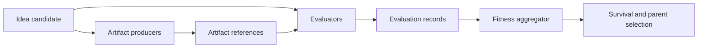

# Pluggable evaluators and artifact-producing ideas

Status: initial design and foundation implemented on `codex/pluggable-evaluators`.

## Goal

Make evaluation optional and composable. Preserve the current LLM Swiss-tournament behavior while supporting deterministic or domain-specific metrics, artifact-producing implementations, and LLM evaluation of those artifacts.

Examples this architecture must support:

- the current pairwise LLM judge plus embedding diversity;
- a checked-in Python evaluator that returns a numeric fitness such as accuracy or pLDDT;
- an LLM-produced Python visualization that renders a PNG, followed by a multimodal LLM judge;
- several independent metrics combined into selection fitness;
- display-only evidence that does not affect selection;
- no evaluation at all for runs that only generate and inspect ideas.

## Core separation

The pipeline has four responsibilities:

1. **Artifact producer** — enriches a candidate with evidence, such as source code and a rendered image.
2. **Evaluator** — observes a candidate, pair, selection pool, or global population and emits typed measurements and evidence.
3. **Fitness aggregator** — normalizes configured measurements and computes the scalar selection fitness.
4. **Survival policy** — applies age decay and other population policies after fitness; this is not evaluation.



Components declare the evidence they require and provide. An evaluation coordinator orders them, caches by content digest, and records failures explicitly. This makes `LLM code -> PNG -> visual judge` a normal dependency chain rather than a special case in the evolution loop.

## Candidate and evidence contracts

The existing candidate dictionary remains readable during migration, but new data is typed and serializable:

```python
{
    "id": "...",
    "idea": {"title": "...", "content": "..."},
    "parent_ids": ["..."],
    "artifact_ids": ["artifact-..."],
    "evaluations": {
        "visual_judge": {
            "status": "ok",
            "metrics": {"visual_usefulness": 0.82},
            "normalized_metrics": {"visual_usefulness": 0.82},
            "artifact_ids": ["artifact-..."],
        }
    },
    "selection_metrics": {
        "fitness": 0.74,
        "components": {
            "visual_judge.visual_usefulness": {
                "status": "used",
                "weight": 0.8,
                "raw_value": 0.82,
                "score_value": 0.82,
            },
            "diversity.diversity": {
                "status": "used",
                "weight": 0.2,
                "raw_value": 0.42,
                "score_value": 0.42,
            },
        },
    },
}
```

Artifact binaries do not belong in Firestore generation history. `ArtifactRef` contains an opaque storage key, media type, byte size, digest, role, producer identity, and content digest. Local disk is the first artifact-store backend; object storage can implement the same interface later.

Each `EvaluationRecord` includes:

- evaluator ID, kind, and version;
- generation and scope;
- `ok`, `failed`, `skipped`, or `cached` status;
- raw and normalized metrics;
- referenced artifact IDs;
- concise summary or rationale;
- explicit error details;
- duration and input digest.

Failures are never converted into ties or numeric zero. A component config chooses one policy:

- `fail_run`: stop aggregation when the configured evidence is unavailable;
- `penalize`: contribute the configured penalty score and retain the failure;
- `omit`: omit the metric and renormalize the remaining weights.

Display-only evidence is represented by leaving the component out of the
fitness metric list (or assigning it zero weight), so its record remains
inspectable without influencing selection.

## Script result contract

Evaluators and producers write a strict result file rather than encoding data in console output:

```json
{
  "schema_version": 1,
  "status": "ok",
  "metrics": {
    "score": 0.82,
    "plddt": 91.4
  },
  "artifacts": [
    {
      "path": "visualization.png",
      "role": "primary",
      "media_type": "image/png"
    }
  ],
  "summary": "Optional short explanation"
}
```

Metric configuration provides selection weight, optimization direction, optional bounds, and normalization strategy. This permits a raw AlphaFold-like score without pretending all domain metrics naturally lie in `[0, 1]`.

## Generated-code security boundary

Generated code must never execute directly inside the FastAPI/Uvicorn process. A subprocess timeout is useful operationally but is not a security boundary.

The generated-code backend will invoke a pinned local Docker or Podman image with:

- no network;
- a non-root user;
- a read-only root filesystem;
- all capabilities dropped and `no-new-privileges`;
- CPU, memory, PID, wall-time, log, file-count, and output-size limits;
- candidate input and source mounted read-only;
- one empty per-job output directory mounted writable;
- no project tree, home directory, container socket, credentials, API keys, or inherited environment;
- pinned NumPy, Matplotlib, and Pillow dependencies, with no runtime installation;
- a fixed command such as `python -I /input/main.py`, never an LLM-generated command.

Before committing outputs, the host rejects traversal, symlinks, device files, unsupported or spoofed media types, and oversized files. Executable templates may suggest a known preset, but custom template text can never silently enable local execution. Every run requires an explicit execution setting and persists its resolved profile and code digest.

## Backward compatibility

Runs with no `evaluation` config resolve to the legacy suite:

- `llm_pairwise.quality_elo` with weight `fitness_alpha`;
- `embedding_diversity.diversity` with weight `1 - fitness_alpha`;
- existing age-decay settings unchanged.

During migration, the system continues writing the `elo`, `diversity`, and `fitness` aliases consumed by existing history, tree, ranked, and chart views.

The first extraction wraps the existing Critic/Swiss implementation; it does not rewrite the tournament algorithm. Critique/refinement remains separate from judging even if both temporarily use the same `Critic` instance.

## Prime-visualization preset

The spiral recalled in the project brief is the Ulam spiral. It is a baseline and anti-copy reference: the goal is to propose new mappings that reveal structure rather than merely restyle it.

A first preset is:

```yaml
evaluation:
  enabled: true
  allow_generated_code_execution: true
  components:
    - id: render
      kind: llm_code_artifact
      execution_profile: matplotlib-prime-v1
      artifact_role: primary
      source_role: source
      provides: [artifact.primary, artifact.source]

    - id: visual_judge
      kind: llm_artifact_score
      requires: [artifact.primary]
      artifact_role: primary
      metric_name: visual_usefulness

    - id: diversity
      kind: embedding_diversity
      metric_name: diversity

  fitness:
    strategy: weighted_sum
    metrics:
      - component_id: visual_judge
        metric_name: visual_usefulness
        weight: 0.8
        direction: maximize
        normalization: bounds
        bounds: [0, 1]
      - component_id: diversity
        metric_name: diversity
        weight: 0.2
        direction: maximize
        normalization: running_zscore
```

The producer prompt requires deterministic, noninteractive Python, a bounded prime range, fixed random seed, PNG output, and metadata explaining how integers map to positions, marks, and color. The visual judge returns structured scores for mathematical fidelity, legibility, revealed prime structure, novelty beyond a restyled Ulam spiral, and usefulness for forming or testing a hypothesis.

## UI information architecture

Cards, Tree, and Ranked remain complementary overview modes but select the same stable idea and open the same persistent inspector.

- **Overview:** idea/hypothesis, what to notice, primary artifact, execution state, selection score, concise verdicts.
- **Artifacts:** lazy-loaded gallery, captions/alt text, media details, versions, and download/open actions.
- **Code & Run:** source tree, generation prompt, execution-profile digest, resource limits, logs, timestamps, and retry state.
- **Evaluations:** aggregate formula, then raw value/unit, normalization, direction, weight, version, status, evidence, and evaluated artifact for each component.
- **Lineage:** parents/children, mutation or migration event, genotype, meaningful diff, and prompt provenance.

Only present tabs backed by data. Ordinary text-only ideas remain simple. Generated HTML/SVG is never inserted into the app DOM; it is rasterized or served through a separate, restrictive sandboxed origin.

## Delivery sequence

1. Add typed suite, artifact, evaluation, failure-policy, and aggregation contracts plus legacy config migration.
2. Extract current LLM tournament and embedding diversity behind evaluator components without changing results.
3. Generalize persisted normalization state while retaining legacy aliases.
4. Add an artifact store and a deterministic, checked-in script evaluator to exercise the contract.
5. Add the isolated container backend and strict output validation.
6. Add LLM code production and multimodal artifact judging.
7. Add the prime preset and the shared artifact/evaluation inspector.

Each stage must round-trip through checkpoint/resume and be independently testable. Real LLM and container integration tests remain opt-in; deterministic fakes cover the default suite.
